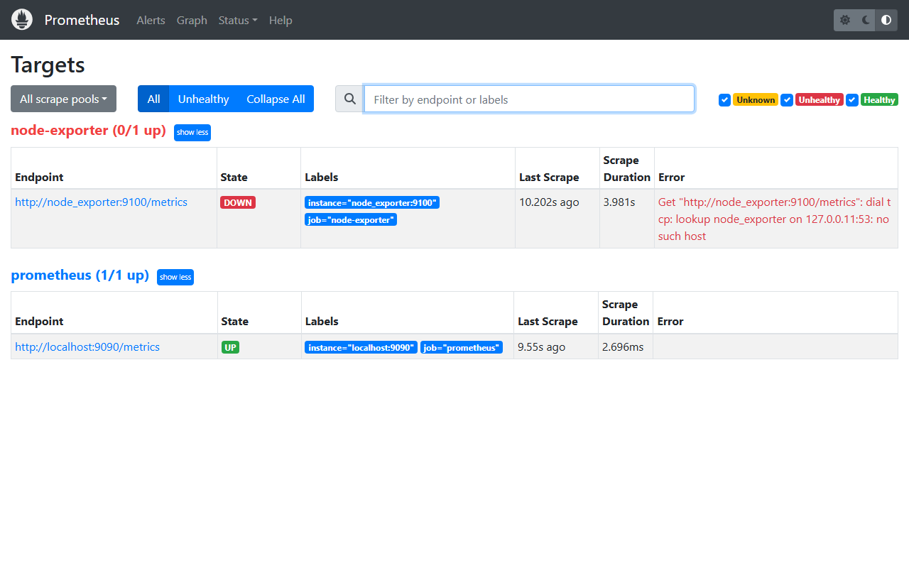

# Docker Monitoring Stack

Host monitoring with Prometheus, Grafana and Node Exporter, started with one `docker compose` command. Node Exporter exposes CPU, memory, disk and network metrics, Prometheus collects them every 15 seconds and Grafana shows them on a dashboard.


## How it works

- `docker-compose.yml` starts three containers on their own bridge network called `monitoring`: Prometheus 2.47, Node Exporter 1.6.1 and Grafana 10.1. Image versions are pinned.
- `prometheus/prometheus.yml` tells Prometheus to scrape itself and `node-exporter:9100`.
- `grafana/provisioning/` adds the Prometheus data source automatically and tells Grafana where to look for dashboards.
- Prometheus data and Grafana settings live in named volumes, so they survive a restart.
- The Grafana login comes from a `.env` file that is not committed.

## Run it

You need Docker with the Compose plugin.

```bash
git clone https://github.com/OliwierOzgaIT/docker-monitoring-stack.git
cd docker-monitoring-stack
cp .env.example .env        # then set GRAFANA_USER and GRAFANA_PASSWORD
docker compose up -d
```

| Service | Address |
|---|---|
| Prometheus | http://localhost:9090 |
| Node Exporter metrics | http://localhost:9100/metrics |
| Grafana | http://localhost:3000 (login from your `.env`) |

The dashboard JSON is not stored in this repo. To get the same view, download the "Node Exporter Full" dashboard (ID 1860) from grafana.com into `grafana/provisioning/dashboards/` and restart Grafana, or import ID 1860 in the Grafana UI.

Stop it with `docker compose down`. Add `-v` to delete the stored data too.

## Problems I ran into

- **Node Exporter showed as DOWN in Prometheus.** The scrape target said `node_exporter` with an underscore, but the service is called `node-exporter`. Docker DNS uses the exact service name.

  

- **Compose printed a warning on every command.** The `version:` field is obsolete in Compose v2, so I removed it.
- **Grafana said "Dashboard not found".** Provisioning only points to a folder; the dashboard JSON has to be in that folder.

## What I learned

- How containers find each other by service name on a user-defined network.
- How Prometheus targets and Grafana provisioning fit together.
- Keeping credentials out of the repository with a `.env` file.
