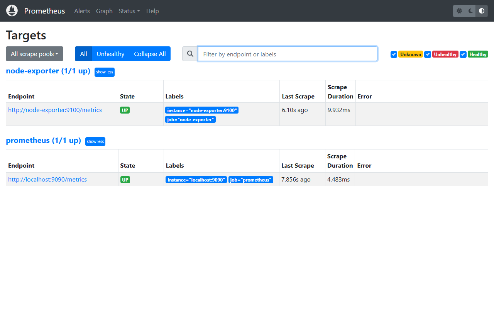
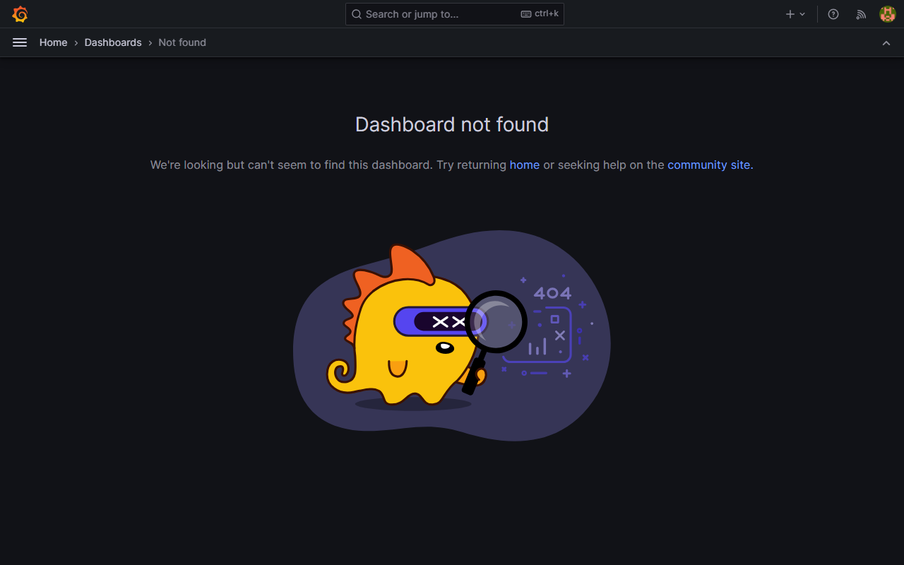

# 🐳 Docker Monitoring Stack

[](https://www.docker.com)
[](https://prometheus.io)
[](https://grafana.com)
[](https://opensource.org/licenses/MIT)

A production-style observability stack running entirely in Docker — Prometheus scraping metrics, Node Exporter exposing host-level data, and Grafana rendering it as a live dashboard.

This project demonstrates how to wire three open-source monitoring tools into a coherent pipeline using Docker Compose, with all configuration managed as code and credentials injected via environment variables.

---

## 🎯 Objective

The goal is to build a self-contained monitoring environment that mirrors what a DevOps or security engineer would encounter in a real infrastructure role. Rather than clicking through a hosted SaaS dashboard, this stack is provisioned entirely from config files — data sources, dashboards, and network topology included — so the whole thing spins up with a single command and produces a working observability layer from scratch.

---

## ✨ Key Features

- **Metrics Collection:** Prometheus scrapes both itself and Node Exporter on a 15-second interval, storing time-series data in a named Docker volume.
- **Host Telemetry:** Node Exporter exposes CPU, memory, disk I/O, network throughput, and filesystem metrics from the host.
- **Auto-Provisioned Dashboards:** Grafana loads the Node Exporter Full dashboard (ID 1860) automatically on first boot via provisioning files — no manual import needed.
- **Auto-Provisioned Datasource:** The Prometheus datasource is configured at startup with a fixed UID, so dashboard queries resolve without any manual setup.
- **Isolated Network:** All three services communicate over a dedicated bridge network (`monitoring`), not the default Docker bridge.
- **Environment-Based Secrets:** Grafana credentials are never hardcoded — they are injected from a `.env` file excluded from version control.
- **Persistent Storage:** Named volumes retain Prometheus TSDB data and Grafana state across container restarts.

---

## 🛠️ Tech Stack

| Layer | Technology |
|---|---|
| Orchestration | Docker Compose |
| Metrics Backend | Prometheus 2.47.0 |
| Host Metrics Agent | Node Exporter 1.6.1 |
| Visualization | Grafana 10.1.0 |
| Networking | Docker bridge network (`monitoring`) |
| Secrets | `.env` file — excluded from source control |
| Storage | Docker named volumes (`prometheus_data`, `grafana_data`) |

---

## 🏗️ Architecture

Node Exporter runs as a sidecar container, exposing raw host metrics at `/metrics` on port 9100. Prometheus scrapes both Node Exporter and its own internal metrics every 15 seconds, persisting the time-series data to a named volume. Grafana connects to Prometheus via the internal Docker network — no ports exposed between containers, only the final UI ports are bound to the host.

```
  Host Machine
  ┌─────────────────────────────────────────────┐
  │                                             │
  │  ┌──────────────┐   scrape :9100            │
  │  │  Prometheus  │◄─────────────────────┐   │
  │  │  :9090       │                      │   │
  │  │              │   scrape :9090       │   │
  │  │              │◄──────────┐          │   │
  │  └──────┬───────┘           │          │   │
  │         │ query             │    ┌─────┴──────────┐
  │         ▼                   │    │ Node Exporter  │
  │  ┌──────────────┐           │    │ :9100          │
  │  │   Grafana    │           │    └────────────────┘
  │  │   :3000      │           │
  │  └──────────────┘    ┌──────┴───┐
  │                      │Prometheus│
  │  [monitoring network]│  itself  │
  └─────────────────────────────────┘

  Host ports exposed: 9090 (Prometheus), 9100 (Node Exporter), 3000 (Grafana)
```

---

## 📂 Repository Structure

```
docker-monitoring-stack/
├── .env                                  # Grafana credentials (not committed)
├── .gitignore
├── docker-compose.yml                    # Stack definition
├── screenshots/                          # Deployment evidence
├── prometheus/
│   └── prometheus.yml                    # Scrape config
└── grafana/
    └── provisioning/
        ├── datasources/
        │   └── prometheus.yml            # Auto-wires Prometheus datasource
        └── dashboards/
            └── dashboard.yml             # Tells Grafana where to load dashboards
```

---

## 🚀 Getting Started

### Prerequisites

- **Docker** — Version 20.10 or higher
- **Docker Compose** — Included with Docker Desktop

### 1 — Clone the repository

```bash
git clone https://github.com/OliwierOzgaIT/docker-monitoring-stack.git
cd docker-monitoring-stack
```

### 2 — Configure environment

```bash
cp .env.example .env
# Edit .env — set GRAFANA_USER and GRAFANA_PASSWORD
```

### 3 — Start the stack

```bash
docker compose up -d
```

### 4 — Access the services

| Service | URL | Credentials |
|---|---|---|
| Prometheus | http://localhost:9090 | — |
| Node Exporter | http://localhost:9100/metrics | — |
| Grafana | http://localhost:3000 | admin / admin123 |

In Grafana, navigate to **Dashboards → Node Exporter Full** — it loads automatically without any manual import.





---

## 🧩 Challenges & Solutions

### 1. Wrong Service Hostname in Prometheus Scrape Config

| | |
|:---|:---|
| **Issue** | Node Exporter target showed `connection refused` in Prometheus — the `/targets` page listed it as DOWN immediately after the stack started. |
| **Cause** | The scrape target was configured as `node_exporter:9100` (underscore) instead of `node-exporter:9100` (hyphen). Docker resolves service names using the exact name from `docker-compose.yml`, so the DNS lookup for `node_exporter` returned nothing. |
| **Solution** | Corrected the target hostname in `prometheus/prometheus.yml` to match the Docker service name exactly, then restarted the Prometheus container. Both targets showed UP within seconds. |


---

### 2. Obsolete `version` Field Causing Compose Warnings

| | |
|:---|:---|
| **Issue** | Every `docker compose` command printed a warning: `the attribute 'version' is obsolete, it will be ignored`. |
| **Cause** | Docker Compose v2 dropped the `version` field from the Compose spec. Including `version: '3.8'` in `docker-compose.yml` is now treated as a legacy attribute and triggers a warning on every command. |
| **Solution** | Removed the `version` field from `docker-compose.yml` entirely. The file is valid without it in Compose v2 — the schema version is inferred automatically. |

---

### 3. Grafana Dashboard Not Loading on First Boot

| | |
|:---|:---|
| **Issue** | After the stack started, the Grafana dashboard page showed "Dashboard not found" even though the provisioning file was in place. |
| **Cause** | The `dashboard.yml` provider pointed to the provisioning directory, but no actual dashboard JSON file existed there — the provisioning config only tells Grafana *where* to look, not *what* to load. The Node Exporter Full dashboard (ID 1860) needed to be downloaded as a JSON file and placed in that directory. |
| **Solution** | Downloaded the Node Exporter Full dashboard JSON from grafana.com and placed it in `grafana/provisioning/dashboards/`. After restarting Grafana, the dashboard appeared automatically. For a leaner setup without the JSON file, the dashboard can be imported manually via the UI at ID 1860 after first login. |

---

## 🔐 Security Considerations

| Control | Implementation |
|:---|:---|
| **No secrets in source control** | `.env` file is listed in `.gitignore` — credentials never reach the repository. |
| **Network isolation** | All inter-service traffic uses the `monitoring` bridge network. Node Exporter and Prometheus are not directly reachable from outside without explicit port bindings. |
| **Least-privilege volumes** | Prometheus data volume is mounted read-write only for the Prometheus container. Grafana state is isolated to its own volume. |
| **Env var injection** | `GF_SECURITY_ADMIN_USER` and `GF_SECURITY_ADMIN_PASSWORD` are injected at runtime from `.env` — not baked into the image or hardcoded in YAML. |
| **Production hardening** | In a real deployment, Prometheus and Node Exporter ports (9090, 9100) would be removed from host bindings and accessed only through a reverse proxy with auth. |

---

## 🏁 Conclusion

This stack proves that a fully functional observability layer — metrics collection, host telemetry, and live dashboards — can be stood up in minutes from a handful of config files. Every component is pinned to a specific image version, configured as code, and isolated on a private network.

### 💡 Key Takeaways

- **DNS is exact in Docker** — container-to-container communication uses the service name from `docker-compose.yml` verbatim; an underscore vs. hyphen mismatch silently breaks scraping with no obvious error message.
- **Provisioning ≠ importing** — Grafana's provisioning system tells the server where config files live; you still need the actual JSON dashboard file in that path for it to render anything.
- **Named volumes outlive containers** — Prometheus TSDB data and Grafana state survive `docker compose down` and are restored on the next `up`, which matters when you want historical metrics to persist across restarts.
- **Compose v2 is the standard** — the `version` field is dead; any new Compose file should omit it to stay compatible with current tooling without warnings.

---

## 👤 Author

**Oliwier Ozga** — [LinkedIn](https://www.linkedin.com/in/oliwier-ozga-380192405/)

---
